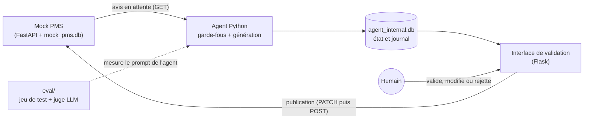

# Agent IA de réponse aux avis clients, mesuré

Un gestionnaire de locations saisonnières reçoit environ **200 avis clients par semaine** sur Airbnb, Booking, VRBO et son propre site. Chaque avis mérite une réponse publique, dans les 14 jours.

Ce projet confie la rédaction à un agent IA. L'agent récupère les avis, écarte les cas à risque, écrit une réponse adaptée à la note, et un humain valide chaque réponse avant publication.

Une démo ne prouve pas grand-chose ici. Ce que le projet montre, ce sont des **mesures** : un jeu de test annoté, un juge LLM, deux versions de prompt comparées, et un taux de retouche relevé sur un vrai lot.

<!-- Démo : remplacer cette ligne par le GIF ou la vidéo, par exemple  -->

## Résultats en bref

| Mesure | Prompt v1 | Prompt v2 |
|---|---|---|
| Réponses sans aucun défaut (jeu de test, 102 réponses) | 49 % | **79 %** |
| Réponses contenant une promesse d'action | 43 | **6** |
| Réponses qui commencent par « nous vous remercions » | 52 % | **13 %** |
| Taux de retouche humaine (lot réel de 50 avis) | — | **2 %** |
| % d'avis traités sans détour (lot réel) | — | **98 %** |

Les limites de ces chiffres sont détaillées plus bas. Elles font partie du résultat.

## Comment ça marche



Deux systèmes séparés, chacun avec sa base :

- **`mock_pms/`** simule le logiciel de gestion (PMS) du client. Il ne connaît que trois statuts (`en_attente_evaluation`, `en_attente_publication`, `publié`) et impose ses transitions côté serveur, comme le ferait une vraie API. On n'y accède que par HTTP.
- **`agent/`** contient le cœur du projet. À chaque run, il récupère les avis en attente, du plus ancien au plus récent, et applique pour chacun :
  1. **des garde-fous** : avis très négatif (à surveiller), doublon (similarité de texte), hors-sujet (classifieur LLM), proximité de la limite des 14 jours ;
  2. **la génération** d'une réponse au ton adapté à la note, avec un score de confiance.

  L'agent ne publie jamais rien lui-même. Les doublons et les hors-sujet ne reçoivent pas de réponse automatique : ils partent en revue manuelle.
- **`admin/`** est l'interface de validation. Elle propose quatre pages : la file de validation, la revue manuelle (doublons et hors-sujet), les avis à traiter à la main (après trois rejets), et un tableau de bord. Un rejet relance la génération, deux fois au plus.
- **`eval/`** mesure une version de prompt sur un jeu de test annoté, sans toucher aux bases ni au PMS.

Tous les réglages métier (seuils, tons par note, nombre de tentatives, modèle, version de prompt) sont dans [`agent/config.yaml`](agent/config.yaml).

## La mesure

### Le jeu de test

[`eval/dataset.json`](eval/dataset.json) contient **39 avis annotés** : 8 classiques et 31 cas difficiles (négatifs à risque, avis mixtes, hors-sujet, contradictions entre note et texte, tentatives de manipulation, avis en langue étrangère, très courts ou très longs). Pour chaque avis, l'annotation donne la réponse attendue, les détails que la réponse doit citer, les mots interdits et la fourchette de score attendue.

Chaque réponse est générée trois fois (température 0,7), soit 102 réponses par version, et contrôlée de deux façons :

- **des règles en Python** ([`metriques.py`](eval/metriques.py)) : longueur, vouvoiement, français, détail cité, mots interdits, répétitions entre réponses ;
- **un LLM juge** ([`juge.py`](eval/juge.py), gpt-4o à température 0) pour ce qu'une liste de mots rate : promesse d'action, compensation, enquête annoncée, aveu de faute, contradiction ignorée. Sa grille est versionnée dans [`eval/prompts/juge_v1.yaml`](eval/prompts/juge_v1.yaml) et n'a pas changé entre les deux versions, sinon les chiffres ne se compareraient plus.

### De v1 à v2

Le premier rapport ([`v1_…txt`](eval/resultats/v1_2026-11-11_025132.txt)) a fait apparaître quatre problèmes :

1. **Des promesses dans 43 réponses sur 102.** « Nous allons revoir notre ménage » engage le gestionnaire sur une action que personne n'a décidée.
2. **Des réponses toutes pareilles.** Pour les notes 1 à 4, 100 % commençaient par « nous vous remercions » et 86 % contenaient « sincèrement désolés ».
3. **Deux faux hors-sujet.** Le classifieur rejetait des avis mixtes, qui parlaient du logement et d'une livraison.
4. **Un score de confiance tassé sur 85**, le repère donné en exemple dans le prompt.

Le prompt v2 ([`v2.yaml`](agent/prompts/v2.yaml)) corrige chacun de ces points. Il est ajouté à côté du v1, qui reste intact pour la comparaison. Résultat ([`v2_…txt`](eval/resultats/v2_2026-11-14_234558.txt)) : **79 % de réponses sans défaut** au lieu de 49 %, 6 promesses au lieu de 43, 2 enquêtes au lieu de 12.

v2 a aussi introduit des régressions, toutes mesurées :

- **plus d'aveux de faute** (5 au lieu de 2) : les réponses reprennent parfois les mots du client, comme « inacceptable » ;
- **deux nouveaux faux hors-sujet** : une plainte sur la caution, et un avis négatif sans aucun détail ;
- **un nouveau tic** : « nous sommes sincèrement désolés » ouvre 64 % des réponses aux notes 1 à 4.

### Sur un lot réel

Cinquante avis du mock PMS ont été traités par l'agent (prompt v2), puis relus un par un dans l'interface.

- **Taux de retouche : 2 %.** Une seule réponse sur 49 a été modifiée avant publication. Avec si peu d'avis, la vraie valeur se situe entre environ 0,5 % et 11 %.
- **98 % des avis traités sans détour** (ni régénération, ni revue manuelle, ni erreur). Le seul raté est un faux hors-sujet : « Une expérience décevante, le service n'était pas à la hauteur. »

Ce lot a aussi révélé un défaut que le jeu de test n'avait pas vu. En interdisant les promesses, v2 n'a laissé au modèle qu'une seule action autorisée : dire que les remarques sont transmises. Résultat : « équipes concernées » apparaît dans **8 réponses sur 18** aux notes 1 à 4. Chaque réponse prise seule reste correcte, mais la répétition se voit dès qu'on lit toutes les réponses d'une annonce.

### Ce que ces chiffres ne disent pas

- **Le jeu de test est volontairement chargé en cas difficiles.** Il sert à comparer des versions de prompt, pas à prédire la qualité sur une semaine ordinaire. C'est pour cela que le taux de retouche est mesuré à part, sur un lot réel.
- **Les exemples ajoutés au prompt v2 visent les mêmes types de cas que le jeu de test**, avec d'autres situations. Le gain v1 → v2 est donc sans doute un peu flatteur.
- **Le taux de retouche a été mesuré par un seul relecteur, l'auteur du projet**, sur 50 avis. Avec 48 réponses validées telles quelles, une relecture indulgente n'est pas exclue.
- **Les avis sont fictifs**, générés par un LLM ([`seed_data.py`](mock_pms/seed_data.py)).

## Décisions de conception

Le cahier des charges laissait douze zones grises. Elles sont tranchées et justifiées dans [`cdc-notes.md`](cdc-notes.md), qui sert aussi de journal de bord. Les principales :

- **Toute publication passe par un humain**, sans exception, y compris pour les réponses à 95 de confiance.
- **Un avis très négatif reçoit quand même une réponse**, avec un badge « à surveiller » ; on ne laisse pas une critique sans réponse publique.
- **Pas de réponse automatique aux doublons et aux hors-sujet** : un humain décide de les écarter ou d'y répondre lui-même.
- **Le score de confiance note la réponse, pas l'avis.** La difficulté de l'avis est portée par les flags.
- **Toute modification de prompt crée un nouveau fichier** (`v1.yaml`, `v2.yaml`…), pour que chaque version reste mesurable.

## Lancer le projet

Python 3.12, une clé OpenAI. Les imports sont à plat : chaque service se lance depuis son propre dossier.

```bash
python -m venv venv && source venv/bin/activate
pip install -r requirements.txt
export OPENAI_API_KEY=sk-...
```

```bash
# 1. Le mock PMS (port 8000, documentation sur /docs)
cd mock_pms && uvicorn main:app --port 8000
cd mock_pms && python seed_data.py       # génère environ 200 avis fictifs (appelle OpenAI)
cd mock_pms && python decaler_dates.py   # redate les avis en attente sur 0 à 16 jours, avant un test

# 2. L'agent (le mock PMS doit tourner)
cd agent && python pipeline.py --limite 20   # traite au plus 20 avis, les plus anciens d'abord
cd agent && python pipeline.py --rejouer     # rejoue les avis en erreur

# 3. L'interface de validation (http://localhost:5000)
cd admin && ADMIN_MOT_DE_PASSE=... flask --app app run --port 5000

# 4. L'évaluation du prompt indiqué dans agent/config.yaml (appelle OpenAI)
cd eval && python run_eval.py   # rapport complet (.json) et résumé (.txt) dans eval/resultats/

# Tests : sans OpenAI ni vraie base (faux LLM, bases temporaires)
pytest tests/
```

### Déclenchement hebdomadaire

L'agent expose une petite API (`cd agent && uvicorn pipeline:app --port 8001`) : `POST /run-pipeline` lance un run en arrière-plan, `GET /run-status` en donne l'état. N'importe quel planificateur peut l'appeler, un cron par exemple :

```
0 8 * * 1  curl -X POST http://localhost:8001/run-pipeline
```

Le plan initial prévoyait n8n pour ce rôle. Il n'a pas été mis en place : il n'aurait fait qu'appeler cette route, et toute la logique reste en Python, où elle est testée. L'API n'a pas d'authentification, elle ne doit donc pas être exposée hors de la machine.

## Structure

```
mock_pms/   faux PMS : API FastAPI, génération et redatation des avis
agent/      pipeline, garde-fous, client LLM, prompts versionnés, config.yaml
admin/      interface de validation Flask et calcul du tableau de bord
eval/       jeu de test annoté, métriques, juge LLM, rapports
tests/      195 tests pytest
cdc-notes.md  cadrage, décisions et journal de bord
```

## Et ensuite

Les pistes d'un prompt v3 sont notées dans le journal, chacune à re-mesurer avant adoption :

- proposer plusieurs façons de réagir à un avis négatif sans rien promettre, pour casser « transmises aux équipes concernées » et « sincèrement désolés » ;
- aligner le ton des notes 1 à 4 dans `config.yaml`, qui demande encore des excuses ;
- apprendre au classifieur qu'une caution ou un avis négatif vague concernent bien la société ;
- interdire de reprendre les accusations du client.

Pour une mise en production : jetons CSRF et HTTPS sur l'interface, et une vraie connexion au PMS du client.
