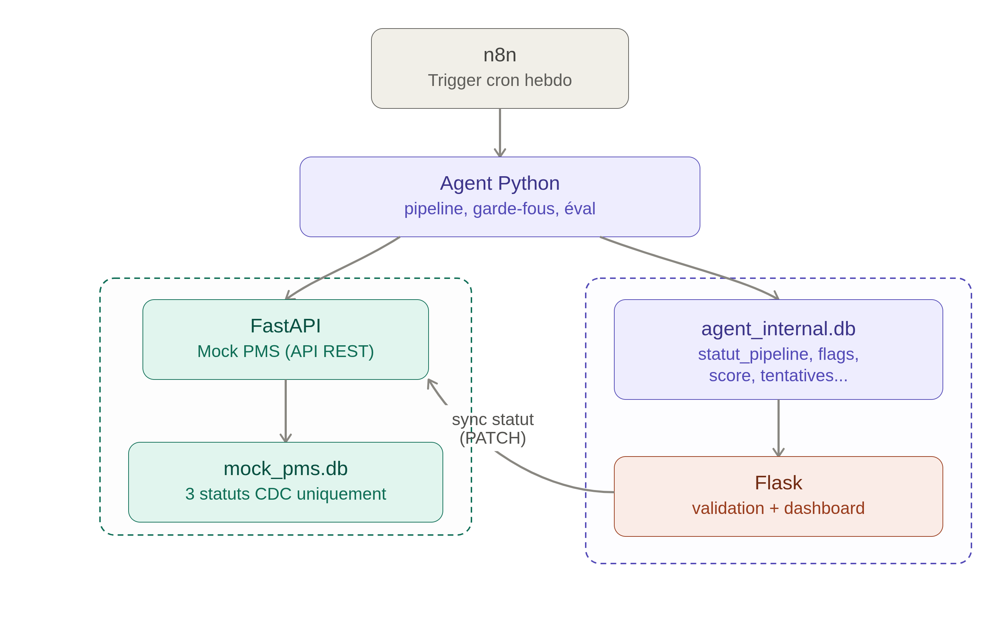

# Agent IA — Réponses aux avis clients
 
## 1. Contexte
- CDC fourni par Thomas, anonymisé, volontairement incomplet.
- Objectif : démontrer une capacité à cadrer + construire un agent IA robuste.
- Ce qui compte pour l'évaluation : taux de retouche humaine, % d'avis automatisés, jeu de cas de test avec réponses attendues.

## 2. Architecture



1. **Mock PMS (API REST)** — un petit backend FastAPI qui simule le PMS : endpoints `GET /reviews`, `POST /reviews/{id}/response`, `PATCH /reviews/{id}/publish`. Données stockées dans SQLite ou Postgres. C'est le "faux client" externe.

2. **Stockage** — une base (SQLite pour un portfolio) qui garde : avis bruts, avis filtrés, réponses générées, statuts, logs, stats. Le CDC le demande explicitement (archivage, historique, reporting).

3. **Agent** (cœur du projet) — Python pur : logique de filtrage, prompt versionné, génération de réponse, garde-fous (ex: détecter avis très négatif → escalade plutôt que réponse auto, détecter langue, détecter hors-sujet/doublon), et une couche d'éval (jeu de cas de test avec réponses attendues, comme il le dit — genre un petit dataset annoté "gold" pour mesurer la qualité).

4. **Interface de validation** — Flask (ou streamlit)

5. **n8n self-hosted** — optionnel, juste pour le trigger hebdo / plomberie. faire tourner n8n et le code Python sur la même machine. l'agent Python n'est pas "hors ligne", il tourne comme un petit service : l'enveloppes dans une API légère (un endpoint FastAPI `POST /run-pipeline` par exemple, séparé du mock PMS ou dans le même service). Le node cron n8n fait juste un `HTTP Request` vers `http://localhost:8001/run-pipeline` chaque lundi. Le script tourne, fait tout le taf (appelle le mock PMS, génère les réponses, etc.), et renvoie un statut à n8n.

---

Details sur la partie "Python" :

* **Prompt versioning** — pas juste "un prompt", il faut un système simple (fichiers versionnés en git, ou table `prompt_versions` en base) pour pouvoir comparer les résultats entre versions.

* **Jeu d'éval** — un dataset séparé (avis + réponse attendue) et un script qui score tes réponses générées contre ce référentiel.

* **Logs/traçabilité** — une table qui trace chaque action (avis traité, réponse générée, validée, publiée, à quelle heure) — exigé par le CDC (section 7 sécurité/conformité).

* **Config paramétrable** — F6 demande seuils/ton/fréquence réglables, donc un fichier config (YAML/JSON) plutôt que des valeurs codées en dur.

Flux Complet :

```
n8n (cron lundi) 
  → GET mock PMS API (avis pending)
  → filtre (vide, déjà traité)
  → LLM génère réponse (nodes n8n ou appel API Claude/OpenAI)
  → écrit en base (statut "à valider")
  → Streamlit affiche la file de validation
  → humain valide/édite
  → n8n (ou action directe Streamlit) → PATCH mock PMS → "publié"
  → stats mises à jour
  ```


## 3. Stack retenue
| Brique | Techno | Rôle |
|---|---|---|
| Mock PMS | FastAPI + SQLite | Simule le système externe (avis, écriture réponses/publication) |
| Cœur agent | Python pur | Filtrage, génération, garde-fous, éval |
| Interface de validation | Flask | UI humaine de relecture/validation, lit et écrit `agent_internal.db`, appelle l'API du PMS pour publier |
| Déclenchement | n8n (self-hosted, local) | Cron hebdo → HTTP call vers l'endpoint `/run-pipeline` de l'agent |


Principe d'architecture : **`mock_pms.db` n'est accessible que par l'API FastAPI** (comme un vrai PMS). L'agent et Flask partagent directement `agent_internal.db`, qui est leur système interne.

## 4. Zones grises — décisions de cadrage
 
| # | Zone grise | Décision |
|---|---|---|
| 1 | F3 et section 7 disent "aucune publication sans validation humaine", mais 3.5/F2 disent que les avis ≥8/10 sont publiés automatiquement. | V1 : validation humaine obligatoire pour tous les avis, pas d'auto-publish même ≥8/10 — choix conservateur pour le portfolio. | 
| 2 | **Validation humaine (3.4) — non spécifiée** - Aucun détail sur l'interface - Qui valide (un seul rôle ? plusieurs personnes ?) - Que se passe-t-il si la réponse est **rejetée** — régénération automatique, ou retour en file d'attente manuelle ? | Un seul validateur (moi, en démo). Affiche : avis original + réponse générée + score de confiance de l'agent. Rejet → régénération automatique (max 2 tentatives), puis bascule en file "à traiter manuellement" si toujours rejetée. | 
| 3 | Avis très négatifs | Défini comme note ≤ 3/10. Réponse générée quand même par l'agent, mise en validation avec un flag "à surveiller". | 
| 4 | Avis multilingues | Réponse toujours générée en français, quelle que soit la langue de l'avis original.| 
| 5 | Avis hors sujet / doublons | Détection des doublons via règles simples (similarité de texte). Détection du hors-sujet via appel LLM classifieur. Dans les deux cas, une fois détecté, l'avis est mis en file de revue manuelle plutôt qu'exclu ou traité automatiquement. | 
| 6 | Réponses trop génériques | On s'appuie sur le score de confiance demandé directement au LLM qui note sa propre confiance sur la réponse générée (ex: 0-100). Affiché dans l'interface de validation à côté de l'avis et de la réponse. | 
| 7 | Gestion des échecs (LLM, API, timeout) | Retry automatique jusqu'à 3 fois en cas d'échec (appel LLM, erreur du mock PMS, timeout). Après 3 échecs, l'avis part dans une file d'erreur spécifique, à traiter manuellement — il ne reste pas simplement "en attente" pour le prochain run automatique. | 
| 8 | Délais de publication (proche des 14j) | Priorisation automatique dans la file de validation : un avis qui approche de la limite remonte en haut de la file, sans alerte ni notification séparée en V1. | 
| 9 | Statuts des avis (pending publication vs pending évaluation) | Le mock PMS expose exactement les 3 statuts du CDC (`en_attente_evaluation`, `en_attente_publication`, `publié`). `en_attente_evaluation` = pas encore traité par l'agent. `en_attente_publication` = réponse générée et validée, en attente de mise en ligne. `publié` = en ligne. Il y'aura aussi des flag interne pour suivre les réponses:  avis très négatif (`à_surveiller`), `hors_sujet`, `doublon`, `priorite_delai`, `status_erreur`|
| 10 | Reporting (format, audience) | Dashboard intégré dans Flask en plus de la validation. Stats minimum affichées : **volume traité par semaine**, **taux de retouche humaine** (% des réponses générées qui ont été éditées avant validation (vs validées telles quelles)), **taux de rejet/régénération** (combien d'avis ont nécessité une ou plusieurs régénérations), **répartition des flags** (combien d'avis "à surveiller", "hors sujet", "doublon", "en erreur" sur la période), **respect des délais** (combien d'avis ont dépassé (ou frôlé) les 14 jours avant validation/publication), score de confiance moyen (tendance dans le temps, utile pour repérer si l'agent "dérive" sur certains types d'avis). | 
| 11 | Sécurité / accès (auth, rétention RGPD) | Login basique (un seul compte) pour l'accès Flask, pas de gestion de rôles multi-utilisateurs en V1. |
| 12 | Génération des réponses (3.3) | **Seuils de ton** (4 paliers) : 1-4 excuse sincère + piste de résolution · 5-6 neutre-professionnel · 7-8 chaleureux, valorise les positifs · 9-10 enthousiaste, invite à revenir. Longueur/structure : réponse courte (2-4 phrases), structure fixe : remerciement → reconnaissance du point mentionné → clôture (invitation à revenir si positif / note d'amélioration si négatif). Base de connaissances : few-shot dans le prompt (3-5 exemples de bonnes réponses inclus directement dans le prompt système) |
  
## 5. Structure du projet (arborescence)
```
project/
├── mock_pms/           # FastAPI : génération avis + endpoints REST
│   ├── main.py
│   ├── models.py
│   └── seed_data.py
├── agent/               # Cœur Python : logique métier
│   ├── pipeline.py      # orchestration principale (/run-pipeline)
│   ├── db_models.py    # ORM SQLAlchemy
│   ├── prompts/         # prompts versionnés
│   ├── guardrails.py    # détection négatif/hors-sujet/doublon/langue
│   ├── llm_client.py    # appel API LLM
│   └── config.yaml      # seuils, ton, fréquence (F6)
├── eval/                # jeu de test + scoring
│   ├── dataset.json     # avis + réponse attendue
│   └── run_eval.py
├── admin/               # Flask : interface de validation
│   ├── app.py
│   └── templates/
├── n8n/
│   └── workflow.json    # export du workflow (cron + HTTP call)
└── cadrage-projet.md    # ce fichier
```

**Example**

| Avis | Statut PMS | Flags internes | Score confiance |
|---|---|---|---|
| "Le service était nul..." | En attente d'évaluation | ⚠️ À surveiller · ⏰ Urgent (délai) | 45 |
| "Bof, rien à dire" | En attente d'évaluation | 🔁 Doublon détecté | 70 |
| "Super séjour, merci !" | En attente de publication | *(aucun flag)* | 92 |

## 6. KPIs de succès
- Temps moyen de traitement hebdomadaire
- % d'avis traités sans intervention supplémentaire (pas d'auto-publication en V1, décision #1)
- Taux de retouche humaine sur les réponses générées
- Respect des délais de publication (< 14 jours)
## 7. Journal de décisions
*(à compléter au fil du projet — date, décision prise, raison)*

- **2026-11-04 — Avis écartés en revue manuelle :** un doublon ou un hors-sujet écarté par le relecteur reste sans réponse publiée. Raison : un avis écarté n'a pas à recevoir de réponse.
- **2026-11-04 — File manuelle :** après 3 rejets, l'avis passe au statut `à_traiter_manuellement` (décision #2). Raison : un avis n'est que dans un seul de ces états, un statut est donc plus simple que des colonnes à combiner.
- **2026-11-04 — KPI « % automatisé » :** il mesure les avis traités sans intervention supplémentaire (ni régénération, ni flag doublon ou hors-sujet, ni erreur). Il ne mesure pas l'auto-publication, exclue en V1 (décision #1), et ne tient pas compte des retouches.
- **2026-11-04 — Écarts avec la décision #12 :** `prompts/v1.yaml` contient 10 exemples au lieu de 3 à 5, pour couvrir les cas ambigus du score de confiance. Pour les notes de 1 à 4, le ton demande des excuses sans rien promettre, au lieu d'une piste de résolution, pour éviter tout engagement commercial. `eval/` dira s'il faut revenir dessus.

---

## Schéma `agent_internal.db`

### Table `avis`

| Colonne | Type | Rôle |
|---|---|---|
| `id` | INTEGER PK | identifiant interne |
| `review_id_pms` | INTEGER | référence à l'avis dans mock_pms.db (clé de liaison) |
| `plateforme` | TEXT | Airbnb / Booking / VRBO / site propriétaire |
| `note` | INTEGER | note de l'avis (1-10) |
| `texte_avis` | TEXT | contenu original |
| `reponse_generee` | TEXT | dernière réponse produite par l'agent |
| `reponse_validee` | TEXT/NULL | texte final approuvé par l'humain (identique ou édité) |
| `statut_pipeline` | Enum Python | nouveau / en_validation / à_traiter_manuellement / écarté / validé / synchronisé_pms |
| `flag_surveillance` | Boolean | True / False |
| `flag_doublon` | BOOLEAN | True / False |
| `flag_hors_sujet` | BOOLEAN | True / False |
| `raison_hors_sujet` | TEXT/NULL | explication du classifieur, affichée en revue manuelle |
| `score_confiance` | INTEGER | 0-100, donné par le LLM |
| `nb_tentatives_regen` | INTEGER | 0-2 |
| `nb_tentatives_erreur` | INTEGER | 0-3 |
| `statut_erreur` | TEXT | ok / en_erreur |
| `priorite_delai` | BOOLEAN | proche des 14 jours |
| `date_avis` | DATE | date de l'avis original (pour calculer le délai) |
| `date_creation` | TIMESTAMP | quand l'agent a traité cet avis |
| `date_validation` | TIMESTAMP/NULL | quand validé par l'humain |

### Table `logs`

| Colonne | Type | Rôle |
|---|---|---|
| `id` | INTEGER PK | identifiant du log |
| `review_id_pms` | TEXT | référence à l'avis concerné |
| `action` | Enum Python | généré / régénéré / validé / rejeté / publié / erreur_finale / signalé |
| `details` | TEXT | contexte libre (ex: "tentative 2/2", "erreur: timeout LLM") |
| `acteur` | Enum Python | agent / humain |
| `timestamp` | TIMESTAMP | quand l'action a eu lieu |

## Schéma `mock_pms.db`

### Table `reviews`

| Colonne | Type | Rôle |
|---|---|---|
| `id` | INTEGER PK | identifiant de l'avis (référencé par `review_id_pms` dans agent_internal.db) |
| `plateforme` | ENUM | airbnb / booking / vrbo / site_proprietaire |
| `note` | INTEGER | note de l'avis (1-10) |
| `commentaire` | TEXT/NULL | contenu de l'avis ; NULL = avis vide (note sans commentaire) |
| `date_avis` | DATE | date de l'avis original |
| `statut` | ENUM | en_attente_evaluation / en_attente_publication / publié |
| `reponse_publiee` | TEXT/NULL | texte final tel que publié sur la plateforme |
| `date_publication` | TIMESTAMP/NULL | date de publication effective |

## Calcul des indicateurs de succès

### Temps moyen de traitement hebdomadaire
Moyenne de `date_validation - date_creation` sur tous les avis traités dans la semaine.
```sql
SELECT AVG(julianday(date_validation) - julianday(date_creation)) AS temps_moyen_jours
FROM avis
WHERE date_validation IS NOT NULL
  AND date_creation BETWEEN '<debut_semaine>' AND '<fin_semaine>';
```
Volume traité par semaine (à mettre en regard) :
```sql
SELECT COUNT(*) FROM avis
WHERE date_creation BETWEEN '<debut_semaine>' AND '<fin_semaine>';
```

### Pourcentage d'avis automatisés
Défini comme : traités par le pipeline sans intervention manuelle supplémentaire (pas de régénération, pas de flag hors-sujet/doublon, pas d'erreur).
```sql
SELECT COUNT(CASE WHEN nb_tentatives_regen = 0 
                   AND flag_doublon = FALSE 
                   AND flag_hors_sujet = FALSE 
                   AND statut_erreur = 'OK' 
                   THEN 1 END) * 100.0 / COUNT(*) AS pct_automatise
FROM avis;
```

### Taux de retouche humaine
Compare `reponse_generee` (dernière réponse proposée par l'agent) à `reponse_validee` (texte final approuvé), uniquement sur les avis déjà validés pour lesquels l'agent a généré une réponse. Les avis doublons ou hors-sujet n'ont pas de réponse générée : ils sont exclus. Les enums sont stockés par leur nom (`VALIDE`, et non `validé`).
```sql
SELECT COUNT(CASE WHEN reponse_validee != reponse_generee THEN 1 END) * 100.0 / COUNT(*) AS taux_retouche
FROM avis
WHERE statut_pipeline IN ('VALIDE', 'SYNCHRONISE_PMS')
  AND reponse_generee IS NOT NULL;
```